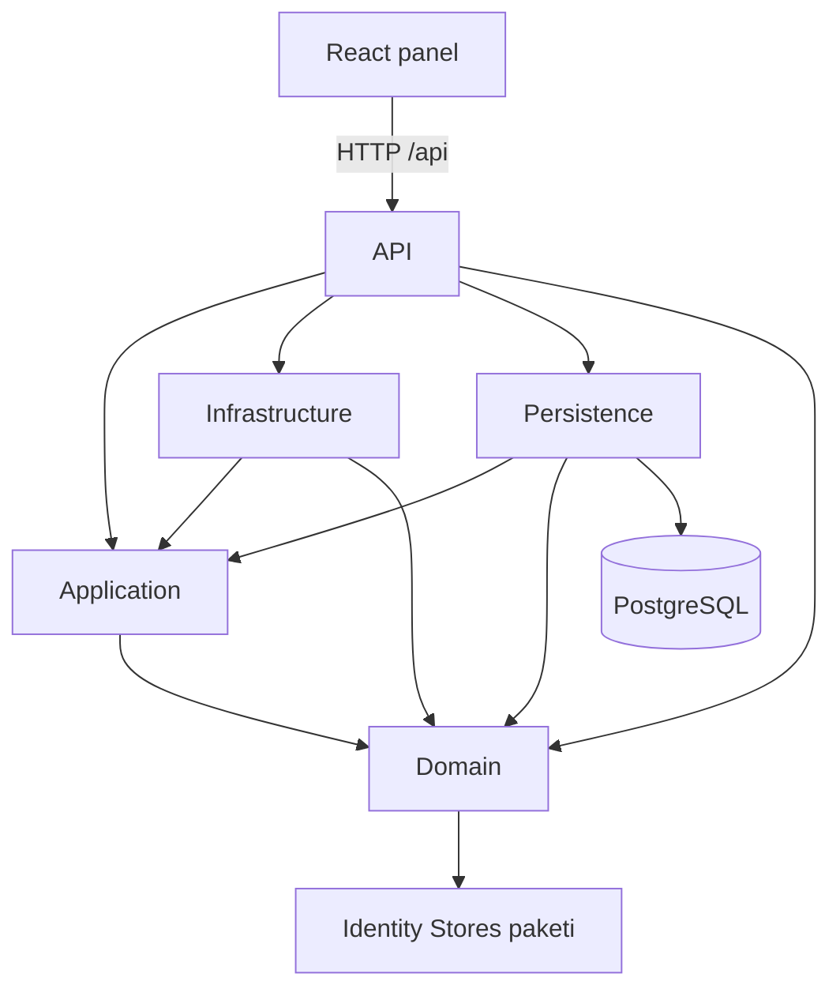
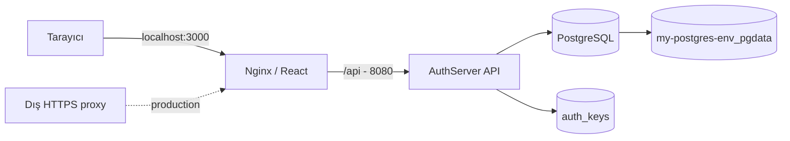
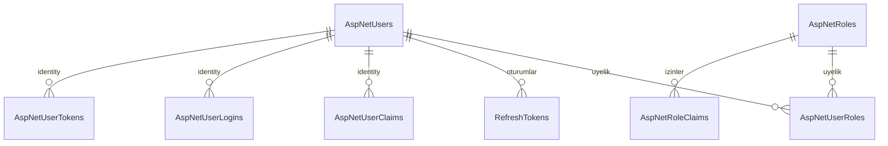
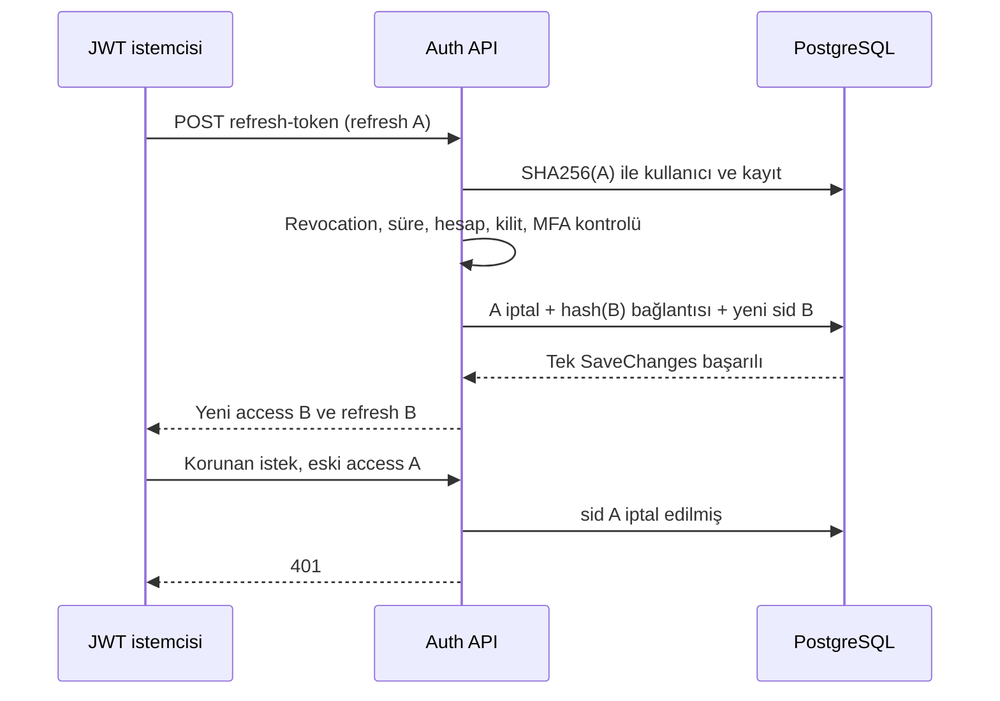
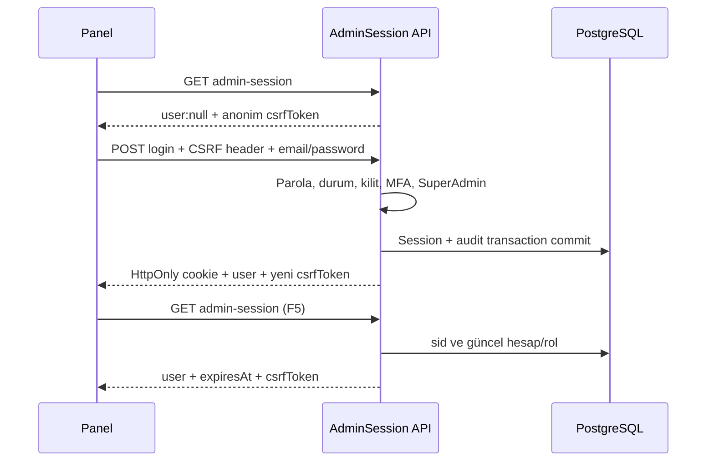

# AuthServer-Onion: ayrıntılı proje rehberi

Bu rehber projeyi devralacak geliştiriciye ve kurup işletecek ekibe yöneliktir. **26 Kasım 2026**, `9f08e66b26308bfcc6707dec99bacfd7ef223374` kaynak sürümü esas alınmış ve yerel çalışma ağacındaki A ve B refactoring dilimlerine göre güncellenmiştir. Sonradan önerilen özellikler mevcut davranış olarak sunulmaz. Bulgular ve doğrulama kanıtları [teknik analizde](PROJECT_ANALYSIS.md) kayıtlıdır.

## İçindekiler

1. [Kapsam ve kavramlar](#scope)
2. [Depo haritası](#repository)
3. [Mimari ve istek hattı](#architecture)
4. [Teknolojiler](#technology)
5. [Yapılandırma](#configuration)
6. [Docker kurulumu](#docker-setup)
7. [Yerel geliştirme](#local-development)
8. [Veri, migration ve seed](#data)
9. [JWT ve refresh](#jwt)
10. [Cookie ve CSRF](#browser-session)
11. [Yetkilendirme](#authorization)
12. [HTTP API başvurusu](#api)
13. [Panel kullanım ve kod rehberi](#panel)
14. [Transaction, audit ve hatalar](#consistency)
15. [Testler](#tests)
16. [HTTPS dağıtımı](#deployment)
17. [İşletim ve yedekleme](#operations)
18. [Sorun giderme](#troubleshooting)
19. [Geliştirme yöntemi](#development-workflow)
20. [Sınırlar ve ilerleme sırası](#roadmap)

<a id="scope"></a>
## 1. Kapsam ve kavramlar

API tüketicisi e-posta/parolayla JWT alabilir, refresh yapabilir ve ilgili girişi kapatabilir. `SuperAdmin` yöneticiler kullanıcı bilgilerini, parolaları, üyelikleri, rolleri, rol izinlerini ve açık oturumları panelden yönetir.

| Kavram | Bu projedeki anlamı |
|---|---|
| Kullanıcı | `AppUser`: Identity hesabı, ad/soyad, aktiflik ve güvenlik alanları |
| Rol | `AppRole`: kullanıcıya bir veya birden fazla atanabilir |
| Permission | Rol claim'i olarak saklanan `permission` türündeki sabit değer |
| Access token | HS256 JWT; `sub`, `sid`, `security_stamp`, rol ve süre alanları taşır |
| Refresh token | Yeni çift üretmek için sunulan rastgele sır; sunucuda özeti tutulur |
| Oturum | `RefreshTokens` satırı; hem JWT hem panel cookie girişleri burada temsil edilir |
| `sid` | Token/cookie'nin bağlı olduğu belirli oturum kaydının Guid `Id` değeri |
| Rotation | Eski refresh kaydını iptal edip yeni kayıt ve token çifti üretme |
| Replay | İptal edilmiş refresh sırrını yenilemede tekrar kullanma |
| Security stamp | Güncel hesapla token/cookie arasında karşılaştırılan güvenlik sürümü |
| Audit | Bazı başarılı işlemlerin aktör, aksiyon, hedef ve ayrıntı kaydı |
| Bootstrap | Kontrollü başlangıçta migration, roller ve yeni yönetici oluşturma |

Ürün OIDC/OAuth 2.0 sağlayıcısı değildir: discovery/JWKS, authorization code + PKCE, client kaydı, consent ve standart SSO yoktur. Laboratuvar permission kataloğu olması, bu depoda laboratuvar iş endpoint'leri olduğu anlamına gelmez. Çoklu tenant veya uygulama bazlı izin ayrımı da yoktur.

<a id="repository"></a>
## 2. Depo haritası

```text
AuthServer.sln
├── AuthServer.Identity.Domain/
│   ├── Entities/                 AppUser, AppRole, RefreshToken, AuditLog
│   ├── Constants/Permissions.cs  İzin kataloğu
│   └── Enums/Roles.cs            Seed edilecek roller
├── AuthServer.Identity.Application/
│   ├── Features/Auth/Commands/   Login, RefreshToken, Revoke, RevokeAll
│   ├── Features/Management/      Users, Roles, Sessions, Dashboard
│   ├── Dtos/                    Veri sözleşmeleri
│   ├── Interfaces/              DbContext, token, audit, current-user
│   ├── Security/                Hash, zincir iptali, son yönetici koruması
│   └── Wrappers/ServiceResponse.cs
├── AuthServer.Identity.Persistence/
│   ├── Context/AppDbContext.cs
│   ├── Configurations/RefreshTokenConfiguration.cs
│   ├── Migrations/              Üç migration ve snapshot
│   ├── Seeds/ContextSeed.cs
│   ├── ManagementTransactionBehavior.cs
│   └── UserSessionState.cs       Sıralı kullanıcı kilitleri ve session epoch iptali
├── AuthServer.Identity.Infrastructure/
│   ├── Services/                JWT, permission, audit, current-user
│   └── Settings/JwtSettings.cs
├── AuthServer.Identity.API/
│   ├── Program.cs               Composition root ve middleware
│   ├── Controllers/             Altı controller
│   ├── Middlewares/             Hata ve JWT oturum doğrulaması
│   ├── Security/                Cookie events ve antiforgery filter
│   └── appsettings*.json
├── AuthServer.Identity.Tests/   PostgreSQL HTTP entegrasyon testleri
├── AuthServer-AdminPanel/
│   ├── src/api.ts               Fetch, CSRF, bootstrap ve yarış yönetimi
│   ├── src/authStore.ts         Bellekte kullanıcı/CSRF durumu
│   ├── src/context/             React auth ve sekme bildirimi
│   ├── src/pages/               Login, Dashboard, Users, Roles, Sessions
│   ├── src/hooks/useResource.ts İptal edilebilir sorgu/polling
│   ├── src/components/          Layout, modal, feedback, sayfalama
│   ├── tests/                   Node/jsdom ve manuel preview fixture
│   ├── vite.config.ts
│   └── nginx.conf
├── .github/workflows/verify.yml
├── .env.example
├── docker-compose.yml
├── guncelle.sh
└── docs/
```

Backend okuma sırası: `Program.cs` → controller → command/query → handler → servis/DbContext → ilgili test. Oturum davranışı tek dosyada değildir: üretim Infrastructure'da, rotation Application'da, JWT doğrulaması middleware'de, cookie doğrulaması API/Security altındadır.

Panel okuma sırası: `App.tsx` → `AuthContext.tsx` → `api.ts`/`authStore.ts` → `Layout.tsx` → sayfa ve `useResource.ts`.

<a id="architecture"></a>
## 3. Mimari ve istek hattı

### 3.1 Bağımlılıklar



Application iş kurallarını MediatR handler'larında toplar. Persistence `IApplicationDbContext` arayüzünü aynı scoped `AppDbContext` instance'ına bağlar. Identity store ve audit bu context'i paylaşabilir. Infrastructure arayüzlerin uygulamalarını sağlar; API composition root'tur.

Domain `IdentityUser<Guid>`/`IdentityRole<Guid>` türetir; Application EF Core ve `UserManager`/`RoleManager` kullanır. Yapı katmanlıdır, ancak iç katmanlar framework'ten bağımsız değildir. Proje dosyasındaki `Repositories`/`Adapters` klasör tanımı, çalışan ayrı bir repository/adapter altyapısı olduğu anlamına gelmez.

### 3.2 İstek sırası

1. Global exception middleware isteği sarar ve beklenmeyen hatayı loglar.
2. Forwarded headers yalnız güvenilen proxy'den `X-Forwarded-Proto` işler.
3. Development'ta OpenAPI eşlenir, diğer ortamlarda HSTS eklenir.
4. HTTPS redirection → routing → CORS → endpoint rate limit çalışır.
5. `Authorization: Bearer ...` varsa JWT, diğer durumda panel cookie şeması seçilir. Geçersiz Bearer mevcut cookie'ye otomatik geri dönmez.
6. Korunan JWT isteklerinde `UserStatusMiddleware` kullanıcı/stamp/sid/bitim/iptal denetler; token rollerini güncel üyelikle değiştirir.
7. Authorization güncel rol/policy'yi değerlendirir.
8. MVC antiforgery filter gerekli değiştirme isteklerini kontrol eder.
9. Controller MediatR'a gönderir; kapsamdaki yönetim komutu transaction behavior içinde çalışır. Handler tek hedefli audit olayını yazar; pipeline commit/rollback yapar.

Cookie kimliği `AdminSessionEvents.ValidatePrincipal` ile authentication sırasında denetlenir; JWT middleware'i bunu ikinci kez kontrol etmez. `[AllowAnonymous]` endpoint'leri JWT oturum middleware denetimini atlar; Auth login/refresh/revoke kendi girdileri üzerinden çalışır.

### 3.3 Topoloji



Compose yalnız paneli loopback'e yayınlar. API/veritabanı Docker ağı içindedir. Dış HTTPS proxy başka konteyner veya makinedeyse loopback'e erişim/topoloji ayrıca düzenlenmelidir.

<a id="technology"></a>
## 4. Teknolojiler

| Bileşen | İncelenen kaynak sürümü |
|---|---|
| .NET hedefi | Tüm C# projelerinde `net10.0` |
| Identity / EF Core | Temel paketler `10.0.2` |
| Npgsql EF sağlayıcısı | `10.0.1` |
| MediatR | `12.4.1` |
| JWT kütüphanesi | `System.IdentityModel.Tokens.Jwt` `8.15.0` |
| OpenAPI | ASP.NET `10.0.2`, doğrudan Microsoft.OpenApi `2.7.5` |
| Backend test | xUnit `2.9.3`, runner `3.0.2`, Test SDK `17.12.0` |
| PostgreSQL | Docker `postgres:16` |
| Node | Docker `node:22-alpine`, CI `22` |
| React / ReactDOM | Lockfile `19.3.0` |
| React Router | Lockfile `7.18.3` |
| TypeScript | Lockfile `6.0.3` |
| Vite / plugin-react | Güncel lockfile `8.3.8` / `6.1.1` |
| jsdom | Lockfile `30.0.1` |
| Web sunucusu | `nginx:alpine` |

`package.json` aralığı ile lockfile tam sürümünü ayırın: Vite aralığı `^8.0.9`, ilk çözümlemesi `8.3.0`, refactoring sonrası çözümlemesi `8.3.8`'dir. Normal kurulum `npm ci` kullanır. Test zincirindeki jsdom Node engine aralığı `^22.22.2 || ^24.15.0 || >=26.0.0` olduğundan 22 serisinde en az **22.22.2** gerekir.

İmajlar digest ile sabitlenmemiştir. Paket güvenliği tarihlidir: ilk incelemede npm audit 12 bildirim vermiştir; güncel sonuç ve sonraki iyileştirmeler [analizde](PROJECT_ANALYSIS.md#verification) izlenir.

<a id="configuration"></a>
## 5. Yapılandırma

### 5.1 Değişkenlerin eşlenmesi

`.env` adları Compose içindir. ASP.NET Core ortam değişkenlerinde `__` hiyerarşi ayracıdır. Compose `JWT_SECRET` değerini `JwtSettings__Secret` olarak API'ye aktarır. Native `dotnet run` için yalnız `JWT_SECRET` tanımlamak yeterli değildir. `.env` .NET tarafından otomatik okunmaz.

| Compose `.env` değişkeni | Varsayılan / görev |
|---|---|
| `POSTGRES_PASSWORD` | Zorunlu; yeni DB kurulumu ve API bağlantısı |
| `JWT_SECRET` | Zorunlu; en az 32 UTF-8 baytlık bağımsız rastgele sır |
| `DATABASE_INITIALIZE` | `false`; migration + seed açar |
| `BOOTSTRAP_ADMIN_EMAIL` | Boş; yeni yönetici e-postası |
| `BOOTSTRAP_ADMIN_PASSWORD` | Boş; en az 12 karakter parola |
| `ADMIN_SESSION_REQUIRE_HTTPS` | Yerel Compose'da `false`; HTTPS dağıtımında `true` |
| `PANEL_PUBLIC_SCHEME` | `http`; Nginx'in API'ye bildireceği sabit şema |
| `TRUSTED_PROXY_NETWORK` | Boş; güvenilen dar Docker/proxy CIDR'ı |

Boş zorunlu sırlar Compose doğrulamasını durdurur. Yeni DB'de initialize kapalıysa şema/roller otomatik oluşturulmaz. Gerçek sırları appsettings dosyalarına veya Git'e yazmayın.

### 5.2 ASP.NET Core ayarları

| Ayar | Ortam değişkeni | Varsayılan / sınır |
|---|---|---|
| `ConnectionStrings:DefaultConnection` | `ConnectionStrings__DefaultConnection` | Boş; zorunlu Npgsql bağlantısı |
| `JwtSettings:Secret` | `JwtSettings__Secret` | Boş; ≥32 UTF-8 bayt |
| `JwtSettings:Issuer` | `JwtSettings__Issuer` | `AuthServer`; boş olamaz |
| `JwtSettings:Audience` | `JwtSettings__Audience` | `AuthServer.Clients`; boş olamaz |
| `JwtSettings:AccessTokenExpirationMinutes` | `JwtSettings__AccessTokenExpirationMinutes` | `15`; >0 ve ≤60, double |
| `JwtSettings:RefreshTokenExpirationDays` | `JwtSettings__RefreshTokenExpirationDays` | `7`; >0 ve ≤90, double |
| `JwtSettings:AbsoluteSessionLifetimeDays` | `JwtSettings__AbsoluteSessionLifetimeDays` | `30`; 1–90 tam sayı, ilk JWT login'de aileye sabitlenir |
| `Database:Initialize` | `Database__Initialize` | `false` |
| `Bootstrap:AdminEmail` | `Bootstrap__AdminEmail` | Boş |
| `Bootstrap:AdminPassword` | `Bootstrap__AdminPassword` | Boş; e-postayla birlikte gerekir |
| `AdminSession:LifetimeHours` | `AdminSession__LifetimeHours` | `12`; 1–168 tam sayı |
| `AdminSession:RequireHttps` | `AdminSession__RequireHttps` | API varsayılanı `true` |
| `DataProtection:KeysPath` | `DataProtection__KeysPath` | API'de boş; Compose `/var/lib/authserver/keys` |
| `ReverseProxy:KnownProxies` | `ReverseProxy__KnownProxies__0` | Açıkça eklenen IP'ler |
| `ReverseProxy:KnownNetworks` | `ReverseProxy__KnownNetworks__0` | Açıkça eklenen CIDR'lar |
| `Cors:AllowedOrigins` | `Cors__AllowedOrigins__0` | Boş dizi |
| `AllowedHosts` | `AllowedHosts` | `*` |
| Çalışma ortamı | `ASPNETCORE_ENVIRONMENT` | Development OpenAPI'yi etkinleştirir |
| Dinleme | `ASPNETCORE_URLS` / `ASPNETCORE_HTTP_PORTS` | Docker HTTP 8080 |

JWT/admin lifetime ayarları başlangıçta doğrulanır. Kod sırrın uzunluğunu denetler; rastgeleliğini ölçmez. Gerçek DB sağlayıcısı `UseNpgsql`'dır; eski SQL Server yorumu güncel davranışı değiştirmez.

CORS yalnız açık origin listesinde etkinleşir; `AllowCredentials` tanımlı değildir. Panel aynı origin `/api` sözleşmesine dayanır. Cookie panelini ayrı origin'e taşımak yalnız CORS ayarı eklemekle tamamlanmaz.

<a id="docker-setup"></a>
## 6. Docker kurulumu

Yeni kurulumda repo kökünde PowerShell 7:

```powershell
Copy-Item .env.example .env
[Convert]::ToBase64String([Security.Cryptography.RandomNumberGenerator]::GetBytes(48))
```

Üretilen sırrı `JWT_SECRET` yapın; DB için bağımsız parola seçin. Bootstrap e-posta/parolasını doldurun ve yalnız ilk kontrollü başlangıç için `DATABASE_INITIALIZE=true` yapın. Bash'te karşılıkları `cp .env.example .env` ve `openssl rand -base64 48`'dir. Uygulama Base64 metnini decode etmez; metnin UTF-8 baytlarını anahtar olarak kullanır.

```powershell
docker compose up -d --build
docker compose ps
docker compose logs --tail 100 authserver-api
```

Panel [http://localhost:3000](http://localhost:3000) adresindedir. PostgreSQL/API host portu açılmaz. İlk girişten sonra `.env` içinde:

```dotenv
DATABASE_INITIALIZE=false
BOOTSTRAP_ADMIN_EMAIL=
BOOTSTRAP_ADMIN_PASSWORD=
```

Ardından `docker compose up -d --force-recreate authserver-api` çalıştırın. `restart` environment'ı yeniden üretmez; değişen ayarın konteynere uygulanması için recreate gerekir.

### Volume ve izolasyon

- DB volume'unun gerçek adı **`my-postgres-env_pgdata`** olarak sabittir.
- Yalnız `docker compose -p başka-ad` kullanmak DB verisini izole etmez; aynı sabit volume tekrar bağlanır. Bağımsız ortamda adları override edip kontrol edin.
- `auth_keys` cookie/antiforgery Data Protection anahtarlarını korur.
- Normal güncellemede `docker compose down -v` kullanmayın; veri/anahtar volume'larını silebilir.
- Mevcut volume'da `.env` parolasını değiştirmek PostgreSQL rolünün gerçek parolasını değiştirmez.
- Yalnız PostgreSQL healthcheck'i tanımlıdır; panel/API için readiness kontrolü yoktur. Panelin açılması API'nin hazır olduğunun kanıtı değildir.

<a id="local-development"></a>
## 7. Yerel geliştirme

### Backend

.NET 10 SDK ve host'tan erişilebilir PostgreSQL 16 hazırlayın. Ayrı `authserver_dev` DB/kullanıcı kullanın; Compose DB'si host'a yayınlanmaz. Repo kökünde PowerShell 7:

```powershell
$env:ASPNETCORE_ENVIRONMENT = 'Development'
$env:ConnectionStrings__DefaultConnection = 'Host=localhost;Port=5432;Database=authserver_dev;Username=authserver_dev;Password=<yerel-parola>'
$env:JwtSettings__Secret = [Convert]::ToBase64String([Security.Cryptography.RandomNumberGenerator]::GetBytes(48))
$env:AdminSession__RequireHttps = 'false'
$env:Database__Initialize = 'true'
$env:Bootstrap__AdminEmail = '<yonetici-e-postasi>'
$env:Bootstrap__AdminPassword = '<en-az-12-karakterli-parola>'
dotnet run --project AuthServer.Identity.API --no-launch-profile --urls http://localhost:8080
```

İlk kurulumdan sonra API'yi durdurun, `Database__Initialize=false` yapın, bootstrap değişkenlerini `Remove-Item Env:Bootstrap__AdminEmail` / `Remove-Item Env:Bootstrap__AdminPassword` ile kaldırıp yeniden çalıştırın. JWT sırrını yeniden üretmek eski JWT'leri geçersiz kılar; oturumların korunması için güvenli yerel yapılandırmada sabit tutun.

Launch profili yalnız `https://localhost:7023` açar. Vite 8080 beklediği için yukarıdaki açık port komutu kullanılır. HTTPS geliştirmede sertifika ve proxy hedefini birlikte düzenleyin. Development OpenAPI JSON `/openapi/v1.json` adresindedir; Swagger UI eklenmemiştir.

### Panel

İkinci terminalde:

```powershell
npm ci --prefix AuthServer-AdminPanel
npm run dev --prefix AuthServer-AdminPanel
```

Vite'ın yazdığı adresi açın (varsayılan 5173). `/api`, `vite.config.ts` ile `http://localhost:8080` adresine proxy edilir. `npm run preview` varsayılan 4173 portunda build önizlemesi açar ve Vite, `preview.proxy` belirtilmezse `server.proxy` ayarını devralır; mevcut `/api` proxy'si API 8080'de çalışıyorsa kullanılabilir. Bu önizleme production Nginx/HTTPS dağıtımı veya gerçek browser E2E kanıtı değildir. Kaynak: [Vite preview.proxy](https://vite.dev/config/preview-options#preview-proxy).

Manuel smoke kontrolü: anonim session'da `user:null`; yönetici login; F5 ile restore; kullanıcı/rol listesi; logout sonrası yeniden giriş; non-admin panel login reddi. Bu liste test prosedürüdür, bütün maddelerin bu belge yazılırken canlı sistemde çalıştırıldığı iddiası değildir.

<a id="data"></a>
## 8. Veri, migration ve seed



| Model | Alanlar ve anlamları |
|---|---|
| `AppUser` | Guid Identity hesabı; email/user name/hash/stamp/lockout; ad, soyad, hesaplanan FullName, UTC CreatedDate, IsActive |
| `AppRole` | Guid Identity rolü; özel ek alan yok |
| `RefreshToken` | Id=sid, UserId, hash Token, Expires, CreatedDate/CreatedByIp, RevokedDate/RevokedByIp, ReasonRevoked, ReplacedByToken, SecurityStamp snapshot, FamilyId/FamilyCreatedAt/AbsoluteExpiresAt |
| `AuditLog` | String aktör UserId, Action, EntityName/EntityId, JSON Details, IP ve UTC tarih |
| `BaseEntity` | Guid Id, CreatedDate, UpdatedDate ve IsDeleted; otomatik soft-delete veya updated-date mekanizması uygulanmış değil |

Audit aktörü için zorunlu kullanıcı FK'sı yoktur. Dashboard e-postayı sonradan eşler, bulamazsa aktör metnini gösterir. Identity login/token tablolarının varlığı sosyal giriş veya MFA endpoint'i olduğu anlamına gelmez.

Refresh `Token` zorunlu, en çok 200 karakter ve unique index'lidir. `RevokedDate` concurrency token'dır. Replacement bağlantısı FK değil, yeni sırrın hash'idir; helper aynı kullanıcı içinde ardılı arar. Oturumlar kullanıcıya 1:N bağlıdır; kullanıcı FK'sı cascade delete tanımlar.

Aktif liste ve dashboard sayımı `RevokedDate == null`, normal/mutlak bitişin gelecekte olması ve kayıt stamp'inin güncel kullanıcı stamp'iyle eşleşmesi koşullarını kullanır. Bu sayım JWT access token sayısı veya kullanıcı hesabının tüm giriş uygunluğu kontrolleri değildir. Cookie ve JWT kayıtları birlikte sayılır; DTO'da session türü ayracı yoktur.

### Migration

| Migration | Etki |
|---|---|
| `20260420180544_InitialPostgres` | Identity, RefreshTokens, AuditLogs başlangıç şeması |
| `20260910090000_HardenRefreshTokens` | Eski sırları `legacy-<Id>` yapar; replacement'ı temizler; eski oturumları iptal eder; Token unique index'i ekler |
| `20261126112131_SessionSecurityPolicy` | Stamp/aile/mutlak bitiş alanları; eski sırları `session-upgrade-<Id>` yapıp bütün eski JWT/cookie oturumlarını kapatma |

SessionSecurityPolicy mevcut satırlardan güvenilir başlangıç/stamp üretemeyeceği için eski bütün girişleri kapatır; kullanıcı/rol/audit verisini korur. Eski refresh yeni bir login'e replay uygulayamasın diye hash'leri siler. Down da oturumları kapatır ve sırları geri getirmez. Kontrollü dağıtımdan sonra bir kez yeniden giriş gerekir. Ayrıntılı karar: [oturum güvenliği tasarımı](SESSION_SECURITY_DESIGN.md).

Hardening eski sırları hash'e dönüştürüp korumaz; geri alınamaz biçimde siler. Down yalnız index'i kaldırır; eski token'ları geri getirmez. Kullanıcı/rol/audit verileri silinmez.

Repo tool manifest/global.json içermez. EF CLI ayrıca gerekir. Projede kullanılan sürümle eşleşen yerel araç örneği (repo kökünde, API connection/JWT ayarları verilerek):

```powershell
dotnet tool install --tool-path ./.tools dotnet-ef --version 10.0.2
./.tools/dotnet-ef migrations list --project AuthServer.Identity.Persistence --startup-project AuthServer.Identity.API
./.tools/dotnet-ef migrations script --idempotent --project AuthServer.Identity.Persistence --startup-project AuthServer.Identity.API --output migration.sql
```

SQL'i gözden geçirip kontrollü dağıtım adımında uygulayın. Doğrudan güncelleme seçilirse hedef bağlantı/yedeği doğrulayıp `./.tools/dotnet-ef database update --project AuthServer.Identity.Persistence --startup-project AuthServer.Identity.API` kullanılır. `.tools` ve oluşturulan SQL normal belge değişikliğinin parçası değildir. Çok instance production'da initialize kalıcı açık bırakılmamalıdır.

### Seed

Initialize açıkken eksik `SuperAdmin`, `LabManager`, `LabTechnician`, `Basic` rolleri oluşturulur; otomatik permission atanmaz. Silinen enum rolü sonraki açık initialize'da yeniden oluşabilir, eski izinleri geri gelmez.

Bootstrap email/parola ikisi boşsa hesap oluşturma atlanır; biri doluysa hata verir. Aynı email mevcut SuperAdmin'e aitse hesap/şifre değiştirilmeden atlanır; yönetici olmayan hesapla eşleşirse açık hatayla durulur ve rol seed'i de geri alınır. Yeni hesap aktif/email-confirmed `System Administrator` olarak oluşturulur ve SuperAdmin atanır.

Migration tamamlandıktan sonra tek `ContextSeed.SeedAsync` giriş noktası eksik roller+yeni yönetici oluşturma/üyeliğini Serializable transaction içinde tamamlar. Herhangi bir Identity/credential hatasında bütün seed geri alınır; yarım yeni yönetici veya seed rolü kalmaz. Mevcut hesabı onarmak/yükseltmek bootstrap'ın görevi değildir; mevcut non-admin email hatasında ayrı bootstrap email seçin veya yetkili yönetici işlemini açıkça uygulayın.

<a id="jwt"></a>
## 9. JWT ve refresh

### Giriş ve korunan istek

JWT login Basic dahil geçerli hesaplara açıktır. Kullanıcı yok/pasif/MFA işaretli ise genel hata; parola kontrolünde lockout sayımı vardır. Başarı yeni sid üretir, refresh hash'ini stage eder ve Login audit'ini aynı scoped DbContext üzerinde tek SaveChanges ile yazar. Audit kaydı başarısızsa session da kalıcı olmaz. Başarılı parola kontrolündeki stamp yakalanır; sıralı kullanıcı row lock sonrasında taze stamp farklıysa token verilmez. Kilit transaction'ı session+audit commit'ine kadar tutulur. Credential/lockout kontrolü bu birimden önce tamamlanır; hatalı parola sayaçları geri alınmaz. Bu sözleşme AuditService'nin paylaşılan context'i save etmesine dayanır; servis uygulaması değiştirilirse korunmalıdır. Başlangıç hatası ve regresyon kanıtı [analizdedir](PROJECT_ANALYSIS.md).

JWT claim'leri `sub`, `email`, `jti`, `sid`, `security_stamp`, `fullName`, roller ve `exp`'dir. HS256 allowlist'i, issuer/audience/lifetime ve imza denetlenir; saat toleransı sıfırdır.

Korunan istek ayrıca güncel kullanıcı varlığı, aktiflik, kilit, MFA, stamp eşitliği ve aynı kullanıcıya ait aktif sid kaydını denetler. JWT'deki eski roller güncel DB rolleriyle değiştirilir. Yetki/oturum iptali access token süresini beklemez. Bu garanti AuthServer istek hattına aittir; yalnız JWT imzasını kontrol eden başka servis iptali kendiliğinden öğrenmez.

### Rotation



Refresh DTO'sundaki `accessToken` opsiyoneldir ve handler tarafından okunmaz. Access süresi dolmuş olabilir; yetki refresh sırrıdır. Her yenileme yeni sid ve normal refresh ömrü verir; fakat FamilyId, ilk başlangıç ve mutlak bitiş değişmez. Varsayılan aile ömrü ilk JWT login'den **30 gündür**. Access ve refresh bitişi kendi normal ömrü ile aile deadline'ının küçük olanıdır. Süre dolunca yeniden parola gerekir. Ayar değişikliği yeni ailelere uygulanır; mevcut aileyi erken bitirmek için oturum iptal edilir.

İptal edilmiş sır, süre kontrolünden önce replay dalına girer; aynı kullanıcının iptal edilmemiş **bütün** kayıtları, bağımsız cihaz ve panel cookie oturumları dahil kapatılır. Aile başına iptal modeli yoktur. İlk denemede expired kayıt iptal edilip reddedilir; aynı sır tekrar refresh için denenirse artık replay dalına girer.

Concurrency kontrolü aynı refresh'in birden çok başarılı ardıl üretmesini engeller. Rotation'ın yakaladığı `DbUpdateConcurrencyException`, başarısız envelope ve **400** olur; başka iptal/yönetim concurrency hataları global middleware'de **409** olabilir.

İstemci tek refresh çalıştırmalı, token çiftini atomik değiştirmeli ve eski access'i bırakmalıdır. Yanıt ağda kaybolmuşsa eski refresh'i kör tekrar göndermek replay tetikleyebilir. Parola/token/refresh değerlerini URL veya loga yazmayın.

### Çıkış ve zincir

`revoke-token` ham refresh sırrını `token` alanında alır; bilinmeyen sır da idempotent başarıdır. Helper A→B→C zincirinde aynı kullanıcıya ait ardılları izler, açık olanları kapatır. Eski sırdan logout/eskimiş panel satırından kill güncel ardılı da kapatır; diğer bağımsız login'leri etkilemez. Döngü/eksik ardıl başarı sayılmaz; hata oluşturur.

`revoke-all` görünür iptal edilmemiş kayıtları kapatır ve kullanıcı epoch'unu değiştirerek bütün eski girişleri mantıksal olarak geçersiz kılar. Komut Auth namespace'inde kalsa da `IManagementCommand` uygular ve diğer yönetim mutasyonlarıyla aynı Serializable transaction ve tek handler audit kapsamındadır. Audit hatasında iptal rollback edilir; gerçek peer IP kaydedilir. Tüm-session iptali security stamp epoch'unu döndürür; Serializable snapshot'ında görünmeyen eşzamanlı satırlar da eski stamp'le erişemez. İptalden sonra yeni credential doğrulamasıyla başlayan bağımsız giriş geçerlidir. Eski snapshot'ı kaybeden yönetim işlemi 409 alabilir; başarısız işlem tamamlanmış sayılmaz, kullanıcı son durumu okuyup yeniden çağırmalıdır.

Her satır oluşturulduğu security stamp'i saklar. Dış Identity `UpdateSecurityStampAsync` dahil stamp değişikliği eski access/cookie/refresh'i geçersiz kılar. Login/refresh/revoke/password/deactivation aynı kullanıcı row lock sırasıyla çalışır; cookie A→B geçişinde iki kullanıcı Guid sırasıyla kilitlenir. Tek logout/kill kullanıcı epoch'unu döndürmez, yalnız ilgili replacement zincirini kapatır.

<a id="browser-session"></a>
## 10. Cookie ve CSRF

| Özellik | Davranış |
|---|---|
| Kimlik cookie adı | `AuthServer.AdminSession` |
| Scheme / path | `AdminPanel` / `/api` |
| HttpOnly / SameSite | Açık / Strict |
| Secure | API varsayılanı Always; yalnız yerel HTTP'de açık istisna |
| Ömür | Varsayılan 12 saat; 1–168 saat, mutlak |
| Kalıcılık | Persistent; süre dolmadıysa sayfa/tarayıcı açılışında geri yüklenebilir |
| Sliding renewal | Kapalı; restore süreyi uzatmaz |
| Kontrol | Her authentication'da güncel hesap, stamp, sid, süre ve roller |

Data Protection application name `AuthServer.AdminPanel`'dır. Compose `auth_keys` korur. Native dağıtımda kalıcı KeysPath seçin; dosya deposu tek başına şifreli vault anlamına gelmez.



GET anonim kullanıcı için 200 ve `user:null` döner; 200 tek başına giriş kanıtı değildir. Login yanlış/pasif/kilitli/MFA hesap için 401, doğru parolalı non-admin için 403 döner. Session sırrı tarayıcıya verilmez; cookie JWT refresh yapmaz. Aynı tarayıcıdaki önceki geçerli cookie session yeni girişte iptal edilir.

Antiforgery cookie `AuthServer.Antiforgery`, HttpOnly/Strict/`/api`'dır. JSON request token'ı bellekte tutulur, `X-CSRF-Token` olarak gönderilir. GET/HEAD/OPTIONS dışında AdminSession eylemleri, anonim login dahil CSRF ister. Diğer controller'larda cookie kimliğiyle değişiklik de CSRF ister; Bearer istemcileri aynı kurala tabi değildir.

Açık CSRF reddi `400`, `code:"csrf_invalid"` verir. Panel bunu yalnız bir kez restore edip tekrar deneyebilir; kimlik değişmişse eylemi yeni kullanıcı adına göndermez. Login/logout oturum değişimi kilidi sırasında otomatik CSRF retry yapılmaz. Ağ/500 hatasında değişiklik isteği otomatik tekrarlanmaz.

SuperAdmin rolü kaldırılınca cookie kimliği tamamen anonim olmak zorunda değildir: GET session güncel rollerle kullanıcı döndürebilir, yönetim endpoint'leri 403 olur ve Layout yönetim içeriğini göstermez. Logout DB kaydını iptal eder, cookie'yi siler, anonim CSRF yanıtı verir; panel sunucu başarısı gelmeden yerel kimliği temizlemez.

`revision`/`authMutation` eski yanıtların yeni durumu ezmesini engeller. BroadcastChannel yalnız değişiklik sinyali taşır. Odak/görünürlük ve görünür sekmede 60 saniye kontrolü cookie süresini uzatmaz.

<a id="authorization"></a>
## 11. Yetkilendirme

Bütün UserManagement, RoleManagement, SessionManagement ve Dashboard uçları güncel **SuperAdmin** ister. Laboratuvar izinleri panel erişimi vermez. SuperAdmin/Basic silinemez ve yeniden adlandırılamaz.

Son aktif SuperAdmin pasifleştirilemez veya yönetici rolünden çıkarılamaz. Guard yalnız `IsActive` sayar; diğer yöneticilerin kilit/MFA/parola erişilebilirliğini garanti etmez. İşletimde erişilebilir yedek yönetici/kurtarma süreci gerekir.

Rol atama mevcut üyeliği tamamen değiştirir; delta/yalnız ekleme değildir. Null/boş liste Basic'e döner. Yeni kullanıcı da rol verilmezse Basic olur.

Katalog:

```text
Permissions.Laboratories.View
Permissions.Laboratories.Create
Permissions.Laboratories.Edit
Permissions.Laboratories.Delete
```

Rol claim türü `permission`'dır. Güncelleme mevcut permission claim'lerini kaldırır, katalogda doğrulanan distinct listeyi ekler; başka claim türleri korunur. Null/bilinmeyen liste reddedilir; boş liste temizler. SuperAdmin permission handler bypass'ı claim listesinden bağımsızdır.

Policy'ler kaydedilir, handler güncel DB rol/claim'lerini okur; permission cache'i kullanılmaz. İncelenen controller'larda bu policy'leri tüketen iş endpoint'i yoktur.

Parola en az 12 karakterdir; sayı/özel/büyük/küçük harf zorunluluğu açık değildir. Beş hatalı giriş 15 dakika kilitler. MFA bayrağı tek faktör login/access/cookie/refresh'i reddeder; enrollment/challenge/recovery uygulanmış değildir. Yönetici parola reset token'ını sunucuda üretip tüketir; bu self-service e-posta reset akışı değildir.

<a id="api"></a>
## 12. HTTP API başvurusu

Toplam **23 endpoint** vardır. Aşağıda attribute'lardaki adlandırma kullanılır. `SA` güncel SuperAdmin demektir; cookie ile yapılan bütün değiştirme isteklerinde CSRF gerekir.

| Metot | Yol | Erişim | Body / sonuç |
|---|---|---|---|
| POST | `/api/Auth/login` | Anonim, limit | `{email,password}` → token çifti |
| POST | `/api/Auth/refresh-token` | Anonim, limit | `{refreshToken,accessToken?}` → yeni çift; accessToken okunmaz |
| POST | `/api/Auth/revoke-token` | Anonim, limit | `{token}` → refresh zinciri iptali |
| GET | `/api/admin-session` | Anonim | user/expiresAt/csrfToken |
| POST | `/api/admin-session/login` | Anonim + CSRF, limit | `{email,password}` → SA cookie oturumu |
| POST | `/api/admin-session/logout` | Anonim + CSRF | Cookie/DB session iptali |
| GET | `/api/UserManagement/all-users` | SA | Bütün kullanıcılar/roller |
| POST | `/api/UserManagement/create-user` | SA | `{firstName,lastName,email,password,roles}` |
| PUT | `/api/UserManagement/update-user` | SA | `{userId,firstName,lastName,email}` |
| POST | `/api/UserManagement/change-password` | SA | `{userId,newPassword}` |
| POST | `/api/UserManagement/assign-roles` | SA | `{userId,roles}` tam üyelik listesi |
| POST | `/api/UserManagement/update-status` | SA | `{userId,isActive}` |
| POST | `/api/UserManagement/revoke-all` | SA | `{userId}` |
| GET | `/api/RoleManagement/roles` | SA | id/name listesi |
| POST | `/api/RoleManagement/role` | SA | `{roleName}` |
| PUT | `/api/RoleManagement/role` | SA | `{roleId,newRoleName}` |
| DELETE | `/api/RoleManagement/role/{id}` | SA | Rol silme |
| GET | `/api/RoleManagement/permissions` | SA | Statik string kataloğu |
| POST | `/api/RoleManagement/permissions` | SA | `{roleId,permissions}` |
| GET | `/api/RoleManagement/role-permissions/{id}` | SA | `[{permissionName}]` |
| GET | `/api/SessionManagement/active-sessions` | SA | Aktif kayıt DTO'ları |
| POST | `/api/SessionManagement/kill-session` | SA | `{tokenId}` |
| GET | `/api/Dashboard/stats` | SA | Sayımlar + son 10 audit |

Auth limit havuzu, doğrudan peer IP'si başına dakikada toplam 30 istek, fixed window ve sıfır kuyruktur. Üç JWT ucu ve cookie login aynı policy'yi kullanır; tüm yönetim uçlarına genel limit uygulanmaz.

### 12.1 Yanıt örnekleri

Başarılı token yanıtının temsili biçimi:

```json
{
  "data": {
    "accessToken": "<jwt>",
    "accessTokenExpiration": "2026-11-26T12:15:00Z",
    "refreshToken": "<ham-refresh-sirri>",
    "refreshTokenExpiration": "2026-12-03T12:00:00Z"
  },
  "succeeded": true,
  "message": "Giriş başarılı.",
  "errors": null
}
```

Panel session biçimi:

```json
{
  "succeeded": true,
  "data": {
    "user": {
      "id": "00000000-0000-0000-0000-000000000001",
      "email": "admin@example.invalid",
      "fullName": "System Administrator",
      "roles": ["SuperAdmin"]
    },
    "expiresAt": "2026-11-27T00:00:00Z",
    "csrfToken": "<request-token>"
  }
}
```

Bunlar şema örnekleridir; çalışır sır içermez. Tarihler UTC'dir; panel kullanıcı ortamında biçimlendirebilir. CSRF token'ı tek başına giriş credential'ı değildir.

### 12.2 DTO ve doğrulama ayrıntıları

- Login e-posta required/email format/≤256; parola required/≤256.
- Refresh ve revoke sırrı required/≤1024.
- Oluşturma/güncelleme ad-soyad required/≤256, e-posta required/email/≤256.
- Yeni parola required/≤256; en az 12 kuralı Identity'dedir.
- Rol adı ve rol id metinleri required/≤256.
- UserId/TokenId Guid'dir; Guid.Empty için her komutta ayrı doğrulama bulunmaz.
- Rol/permission koleksiyonlarının iş kuralları handler'dadır. API model doğrulaması, handler iş doğrulaması ve panel form doğrulaması farklı katmanlardır.

`TokenDto` sırları yalnız login/refresh yanıtında taşır. `ActiveSessionDto` ham token/hash dönmez: tokenId, userEmail, fullName, ipAddress, createdDate, expirationDate, isCurrentSession. `DashboardStatsDto`: totalUsers, activeUsers, passiveUsers, totalRoles, totalActiveSessions, latestActivities.

### 12.3 Hata sözleşmesi

| Kod | Tipik sebep / istemci davranışı |
|---|---|
| 200 | Başarılı işlem; anonim session'da user null olabilir |
| 400 | JWT login/refresh iş kuralı, doğrulama, geçersiz rol/izin, csrf_invalid |
| 401 | Geçersiz kimlik, iptal/süre/stamp, cookie login reddi |
| 403 | Güncel SuperAdmin eksikliği veya non-admin panel girişi |
| 409 | Yakalanmadan middleware'e ulaşan concurrency/serialization/deadlock |
| 429 | Auth fixed-window kotası dolu |
| 500 | Beklenmeyen hata; trace referansını logla eşleştirin |

Bütün hatalar aynı envelope değildir. `[ApiController]` validation problem objesi, boş JWT/cookie challenge, özel user-status JSON, CSRF code alanı ve genel ServiceResponse birlikte bulunur. Rate limiter için özel JSON body tanımlı değildir. İstemci status'u ve varsa `errors/message/code` alanlarını birlikte ele almalıdır.

### 12.4 PowerShell ile JWT istemcisi örneği

Yerel API açıkken kendi test hesabınızla:

```powershell
$baseUrl = 'http://localhost:8080'
$loginBody = @{ email = '<e-posta>'; password = '<parola>' } | ConvertTo-Json
$login = Invoke-RestMethod -Method Post -Uri "$baseUrl/api/Auth/login" -ContentType 'application/json' -Body $loginBody
$pair = $login.data
$headers = @{ Authorization = "Bearer $($pair.accessToken)" }
Invoke-RestMethod -Uri "$baseUrl/api/Dashboard/stats" -Headers $headers
```

Dashboard için hesap SuperAdmin olmalıdır. Normal Basic hesap token alabilir fakat bu yönetim isteğine erişemez. Yenileme ve çıkış:

```powershell
$refreshBody = @{ refreshToken = $pair.refreshToken } | ConvertTo-Json
$renewed = Invoke-RestMethod -Method Post -Uri "$baseUrl/api/Auth/refresh-token" -ContentType 'application/json' -Body $refreshBody
$pair = $renewed.data
$logoutBody = @{ token = $pair.refreshToken } | ConvertTo-Json
Invoke-RestMethod -Method Post -Uri "$baseUrl/api/Auth/revoke-token" -ContentType 'application/json' -Body $logoutBody
```

Token çiftini terminal çıktısına dökmeyin. Bu örnekte `$pair` tam çift olarak değiştirilir. Otomatik retry eklenmemiştir; başarısız refresh'te eski sırrı tekrar tüketmeyin.

<a id="panel"></a>
## 13. Panel kullanım ve kod rehberi

| Route | Ekran |
|---|---|
| `/login` | Yönetici girişi |
| `/` | Dashboard'a yönlendirme |
| `/dashboard` | Sayımlar ve son audit |
| `/users` | Kullanıcı ekleme/bilgi/parola/rol/durum/force logout |
| `/roles` | Rol CRUD ve permission atama |
| `/sessions` | Aktif oturumlar ve tek iptal |
| Diğer | Korumalı layout içinde bulunamadı |

Layout bootstrap bitmeden redirect yapmaz. İlk ağ hatasında retry sunar; mevcut kimlikte geçici restore hatası kimliği hemen silmez. Login dönüş hedefi tanınan yerel route'larla sınırlıdır. Kullanıcı id değişince Outlet yeniden oluşturularak eski hesap ekran durumu bırakılır. İstemci route koruması UX sağlar; güvenlik sınırı API'dir.

### Kullanıcı işlemleri

`Users.tsx` bütün kullanıcıları ve güncel rol kataloğunu yükler. Ad/e-posta/rol araması, aktif-pasif filtresi ve 20 satırlık **istemci** sayfalaması vardır. API'den tüm veri indirilir.

- Oluştur: ad, soyad, e-posta, parola/tekrar ve rol seçimi. Boş roller Basic.
- Bilgi: PUT ile yalnız ad/soyad/e-posta değişir; e-posta username'i de değiştirir ve yönetici onayıyla confirmed sayılır.
- Parola: en az 12 karakter/tekrar kontrolü; bütün eski oturumlar iptal edilir.
- Rol: verilen liste tüm üyeliğin yerini alır; son yönetici koruması API'dedir.
- Durum: pasifleştirme session'ları kapatır; yeniden aktifleştirme eski session'ları açmaz.
- Tüm oturumları kapat: hedef hesabın JWT ve cookie kayıtları birlikte etkilenir.

Form hata alınca değerleri korur; busy durumda çift gönderim engellenir. Kullanıcı silme, self-service parola veya e-posta doğrulama ekranı yoktur.

### Roller ve izinler

SuperAdmin/Basic rename/delete düğmeleri gizlidir. SuperAdmin permission formu kapalıdır; yetkisi claim listesiyle kısıtlanmaz. İzin listesi yüklenmeden save yapılmaz. Eski katalog dışı claim görünür kalabilir ve temizlenebilir; yeni gönderimde yalnız katalog değerleri kabul edilir.

Rol değişiminde key/AbortController eski yanıtın yeni seçimi ezmesini engeller. Dirty kontrolü değişiklik olmadan save'i kapatır; başka role geçerken kaydedilmemiş değişiklik uyarısı bulunmaz.

### Oturumlar ve dashboard

Oturum ekranı kullanıcı/e-posta/IP arar, 20 satır sayfalar ve istek bittikten 30 saniye sonra polling yapar. “Bu oturum” düğmesi UI'da kapatma sunmaz; bu, backend'de kendi oturumunu kapatmanın yasak olduğu anlamına gelmez. TokenId ile kill mevcut replacement ardılını da kapatır.

Dashboard 30 saniye polling, dört sayaç ve son 10 audit gösterir. passiveUsers DTO'da vardır, ayrı kart olarak gösterilmez. Tam audit arama/filtre ekranı yoktur.

### İstemci altyapısı

`api.ts` sabit `/api`, same-origin credentials, no-store, 20 saniye timeout kullanır. Validation dizi/sözlüğünü ayrıştırır; 401 kimliği temizler, 403 arka planda restore eder. `restorePromise` eşzamanlı bootstrap'ı birleştirir. `authStore.ts` kullanıcı/CSRF/expiry'yi yalnız modül belleğinde tutar; cookie JavaScript tarafından okunmaz. Eski `localStorage.auth_tokens` silinir.

`useResource` endpoint değişiminde/unmount'ta abort eder; polling üst üste yığılmaz, geçici hatada son başarılı veri ve hata birlikte gösterilebilir. Modal native dialog'dur; feedback alert/status, skip link, caption ve reduced-motion desteği bulunur.

Modern `AbortSignal.any/timeout`, native dialog ve BroadcastChannel kullanılır; eski browser/polyfill test matrisi tanımlı değildir. TypeScript strict/strictNullChecks etkin değildir. jsdom testleri gerçek focus/top-layer, CSS ve bütün sekme davranışını kanıtlamaz.

<a id="consistency"></a>
## 14. Transaction, audit ve hatalar

[`IManagementCommand`](../AuthServer.Identity.Application/Interfaces/IManagementCommand.cs), yönetim mutasyonlarının açık transaction sözleşmesidir. Mevcut 11 komut, Auth altındaki RevokeAll dahil bu arayüzü uygular. Behavior namespace yerine bu işareti denetler; Serializable transaction açar, başarılı IServiceResponse sonrası commit, başarısız sonuçta rollback yapar. Audit'i ilgili handler aynı transaction'da tek kez yazar. Identity'nin ara save çağrıları aynı context/transaction'a katılır. Login/refresh/query bu işaretle yönetim transaction'ına alınmamıştır.

Her başarılı/no-op yönetim mutasyonu tek audit olayı yazar. Aktör UserId, hedef EntityName/EntityId ve peer IP kolonlardadır. Details şeması `{schemaVersion:1,correlationId,outcome:"Succeeded",changes:{...}}` biçimindedir; correlation sunucu TraceIdentifier'ıdır, istemci başlığından alınmaz. Rol/profil/durum/izin değişiminde önceki/yeni değerler; parola/oturum işlemlerinde yalnız güvenli boolean ve Guid metadata bulunur. Parola/hash/stamp/token/reset sırrı whitelist dışında ve ek recursive redaction ile çıkarılır. Audit SaveChanges gerçek request cancellation token'ını alır. Eski audit satırları tarihsel formatıyla korunur; yeni format geriye dönük yeniden yazılmaz.

JWT login session ve audit'i aynı SaveChanges içinde kaydeder; cookie login açık transaction kullanır. Başarısız HTTP işlemlerinin tamamı veya tüm okumalar audit'e yazılmaz. Audit detaylarını güvenlik access log'u veya tam değişiklik geçmişi sanmayın.

Global exception middleware ham exception'ı sunucu loguna trace id ile yazar. EF concurrency ve PostgreSQL `40001`/`40P01` 409, diğerleri 500 olur. İstemci ham exception almaz. RequestAborted kaynaklı cancellation özel ele alınır. Otomatik transaction retry yoktur; işlemin idempotency'si incelenmeden genel retry eklemeyin.

<a id="tests"></a>
## 15. Testler

### Backend

Testler gerçek PostgreSQL ve migration kullanır; in-memory EF değildir. Güncel backend suite 68 vakadır; başlangıçta 18, A turu sonunda 26 vaka vardı. Bootstrap/Audit/Session partial dosyaları aynı xUnit sınıfını paylaşır; DB'yi silen sınıflar paralel çalışmaz. Her test `EnsureDeletedAsync` + `MigrateAsync` ile hedef DB'yi yeniden oluşturur. `AUTH_TEST_DATABASE` zorunludur, DB adı case-sensitive `_tests` ile bitmelidir. Yetkili test rolü DB silip oluşturabilmelidir.

```powershell
$env:AUTH_TEST_DATABASE = 'Host=localhost;Port=5432;Database=authserver_tests;Username=test;Password=<yalniz-test-parolasi>'
dotnet test AuthServer.Identity.Tests/AuthServer.Identity.Tests.csproj --configuration Release
Remove-Item Env:AUTH_TEST_DATABASE
```

Mevcut geliştirme/production bağlantısını vermeyin. Sabit Compose DB volume'u test için farklı `-p` adıyla izole edilmiş sayılmaz. Ayrı container veya bağımsız yeni cluster kullanın.

B turu ek kapsamı: bootstrap failure rollback/idempotence; tüm 11 mutasyonda tek audit/target/correlation/redaction ve rollback/cancellation; stamp değişimi; kontrollü login/refresh/password/revoke yarışları; 30 günlük family deadline/clamp; eski şemadan upgrade ve karşılıklı cookie hesap değişimi. A turu kapsamı: JWT login audit failure rollback ve başarılı atomik save; revoke-all audit failure rollback, JWT+cookie iptali/ayrı aktör korunması; rol audit rollback; bütün yönetim endpoint'lerinde anonim 401/Basic 403; kullanıcı/rol/izin/parola yaşam döngüsü ve 31. auth isteğinde 429. Önceki kapsam: expired access sonrası refresh; eski satırdan kill; eski sırla logout; MFA değişimi; sid izolasyonu/hash storage; rotation/replay; concurrent refresh; son yönetici; rol değişimi/pasiflik; input/lockout; audit rollback; legacy migration; cookie restore/özellikleri; CSRF/logout; demotion/revocation; non-admin reddi; trusted/untrusted proxy.

### Panel

```powershell
npm ci --prefix AuthServer-AdminPanel
npm run build --prefix AuthServer-AdminPanel
npm run lint --prefix AuthServer-AdminPanel
npm test --prefix AuthServer-AdminPanel
npm audit --prefix AuthServer-AdminPanel --audit-level=low
```

10 auth istemcisi + 6 React/jsdom testi vardır. Gerçek TypeScript modülleri/sayfalar derlenir; kopya auth mantığı test edilmez. Restore, tek bootstrap, geçici hata, CSRF retry, mutation 500 retry olmaması, logout, 401/kimlik değişimi, deep link, form PUT/hata koruması, arama/sayfalama, gecikmiş rol ve tek session kill kapsanır.

Native dialog metotları stub, BroadcastChannel testte kapalıdır. Gerçek cookie/ağ/HTTPS, görsel responsive/focus ve tam browser E2E ayrı doğrulamadır. `tests/preview-server.mjs` sahte verili loopback fixture'dır; gerçek güvenlik testi değildir.


### Windows'ta izole PostgreSQL runner

[`scripts/Test-Backend.ps1`](../scripts/Test-Backend.ps1), PowerShell 7/Windows ve önceden hazırlanmış PostgreSQL 16 binary'leriyle her çağrıda yeni cluster oluşturur. Yazılım indirmez, servis kurmaz, mevcut DB'ye bağlanmaz. Test verisi/log/TRX yalnız Git dışında tutulan `artifacts/test-runs` altındadır.

```powershell
pwsh -NoProfile -File scripts/Test-Backend.ps1 -PostgresBinPath ./artifacts/postgresql/16.16-2/server/pgsql/bin
```

Başka checkout'ta binary path'ini kendi PostgreSQL 16 dizininize verin. Bu çalışmada [PostgreSQL Windows dağıtımının](https://www.postgresql.org/download/windows/) yönlendirdiği [EDB binary ZIP'i](https://www.enterprisedb.com/download-postgresql-binaries) kullanılmış, yayımlanan SHA-256 indirmeyle eşleştirilmiştir. Binary'ler depoya eklenmez.

Runner rastgele gizli parola, yalnız 127.0.0.1:55432 ve benzersiz `_tests` DB kullanır. Dolu portta durur; mevcut sunucuya düşmez. Try/finally kendi cluster'ını kapatır, geçici parola dosyasını kaldırır ve test exit kodunu korur. `-Filter 'FullyQualifiedName~TestAdi'` seçeneği desteklenir. Türkçe Windows yolunda PostgreSQL bootstrap'ı için mevcut ASCII 8.3 alias kullanılır; alias yoksa başka dizine kaçmadan hata verir.

Sonuçlar run dizinindeki `results/backend.trx`, `tests.log`, `postgresql.log`, `summary.json` dosyalarındadır. Atılabilir data dizinleri/loglar kendiliğinden silinmez. Kendi test verinizi temizlemeden önce hedefin gerçekten yalnız bu run'a ait olduğunu doğrulayın; repo/prod volume'u silmeyin.

### CI ve kanıt okuma

`.github/workflows/verify.yml`, PR ve master/refactor/** push'larında PostgreSQL 16/.NET10/Node 22 ile backend test, npm ci/audit/build/lint/test ve Compose/Nginx template kontrolü tanımlar. Workflow'u okumak son uzak CI sonucunu doğrulamak değildir.

Test keşfi, build ve test execution farklı kanıtlardır. Gerçek yerel sonuçlar, uyarılar, çalıştırılamayan kontroller ve refactoring sonrası tekrarlar [analiz doğrulama tablosunda](PROJECT_ANALYSIS.md#verification) bulunur.

<a id="deployment"></a>
## 16. HTTPS dağıtımı

Compose TLS sertifikası/sonlandırması sağlamaz. İnternet/intranet erişiminde panelin önüne HTTPS reverse proxy koyun ve HTTP'yi HTTPS'ye yönlendirin.

1. Sertifika, hostname ve dış proxy yönlendirmesini kurun. Panelin loopback portunu yalnız bu proxy üzerinden sunun.
2. `.env`: `ADMIN_SESSION_REQUIRE_HTTPS=true`, `PANEL_PUBLIC_SCHEME=https`.
3. `docker network inspect <compose-projesi>_default` ile ilgili subnet'i bulun; `TRUSTED_PROXY_NETWORK` yalnız gerekli dar CIDR olsun. Güvenilmeyen uygulamalarla paylaşılan geniş ağları eklemeyin.
4. Compose dışında tek IP için `ReverseProxy__KnownProxies__0`, ağ için `ReverseProxy__KnownNetworks__0` kullanılabilir. Varsayılan loopback güveni korunur.
5. API/paneli yeniden oluşturun: `docker compose up -d --build`.
6. HTTPS'te login, F5, form değişikliği, CSRF reddi, logout ve iptal edilmiş oturum kontrolü yapın. Cookie Secure/HttpOnly/Strict olmalıdır.
7. `auth_keys` volume'unu ve application name'i koruyun. Çok instance aynı keyring gerektirir; key dosyası erişimi/şifreleme/yedekleme dağıtım sorumluluğudur.

Nginx template istemciden gelen X-Forwarded-Proto'yu kopyalamaz; dağıtım ayarındaki sabit şemayı gönderir. API yalnız açık güvenilen peer'den bunu işler. Güven eksikse Secure antiforgery hatası oluşabilir; çözüm HTTPS korumasını kapatmak yerine şema/güven zincirini düzeltmektir.

`X-Forwarded-For` işlenmez. Audit ve limiter doğrudan peer IP görür; Nginx arkasındaki kullanıcılar aynı havuzu paylaşabilir. Limiter süreç içidir; çok instance ortak kota/revocation cache tasarımı sağlanmış değildir.

Nginx nosniff, no-referrer ve CSP ekler: script/connect self, frame-ancestors none, inline style izni. CSP XSS'i tek başına ortadan kaldırmaz. API Dockerfile'ında açık non-root USER seçimi yoktur; imaj/çalıştırma yetkileri, kaynak sınırları, secrets vault, image scanning/signing ve ağ izolasyonu işletim planına eklenmelidir.

<a id="operations"></a>
## 17. İşletim ve yedekleme

### Günlük kontroller

```powershell
docker compose ps
docker compose logs --tail 100 authserver-api
docker compose logs --tail 100 authadmin-panel
docker compose exec -T postgres_db pg_isready -U myuser -d AuthServerIdentityDb
```

`/health`/readiness endpoint'i mevcut değildir. pg_isready yalnız PostgreSQL kabul durumunu gösterir; uygulama sorgularının doğruluğunu kanıtlamaz. 401/403/409/429/500 oranları, login hataları, DB kapasitesi ve backup başarısı için merkezi metric/alert sistemi repo tarafından kurulmaz.

### PostgreSQL yedeği

PowerShell sürümlerinde binary pipeline farklarından kaçınmak için dump'ı önce konteyner dosyasına yazın, sonra kopyalayın. Repo kökünde:

```powershell
New-Item -ItemType Directory -Force artifacts/backups | Out-Null
docker compose exec -T postgres_db pg_dump -U myuser -d AuthServerIdentityDb --format=custom --file=/tmp/authserver-backup.dump
docker compose cp postgres_db:/tmp/authserver-backup.dump ./artifacts/backups/authserver-backup.dump
```

Örnek sabit ad kullanır; gerçek işletimde tarihli benzersiz ad ve saklama politikası uygulayın. Backup parola hash'i, e-posta, IP ve audit verisi içerir; erişimi ve şifreli/off-host kopyayı planlayın. `artifacts/` Git dışında tutulur; bu, güvenli yedek kasası olduğu anlamına gelmez.

Restore'u önce ayrı, boş hedefte doğrulayın. Örnek yalnız **ayrı test hedefi** içindir:

```powershell
docker compose exec -T postgres_db createdb -U myuser authserver_restore_check
docker compose exec -T postgres_db pg_restore -U myuser -d authserver_restore_check --exit-on-error --no-owner /tmp/authserver-backup.dump
```

Önceden var olan DB üzerine otomatik clean/overwrite kullanmayın. Restore kontrol DB'sini kaldırmak gerçek silme işlemidir; hedefini doğrulayarak işletim prosedürünüzle yönetin. Bu rehberde canlı DB üzerinde restore çalıştırılmamıştır.

`auth_keys` ayrı yedeklenmelidir; anahtar kaybı açık cookie'leri geçersiz kılar. JWT sırrı/env yapılandırması da güvenli kurtarma sürecinde tutulmalı, rapor/loga eklenmemelidir. DB ve key yedeklerini tutarlı geri yükleme tatbikatında doğrulayın.

### Güncelleme ve geri dönüş

- DB/anahtar yedeği ve bakım penceresi hazırlayın; migration etkisini okuyun.
- Eski/yeni API'yi geçiş sırasında birlikte çalıştırmayın.
- Eski kaynak sürümlerinde bulunmuş sırları rotate edin; bu işlem Git geçmişini temizlemez.
- Migration'ı kontrollü uygulayın, API/paneli uyumlu sürümle dağıtın.
- Başlangıç logu, login/restore/refresh/revoke ve yönetim işlemlerini kontrol edin.
- Hardening migration'ı geri almak eski sırları geri getirmez; eski session'ları açmaya çalışmayın.

`guncelle.sh` yalnız kendi klasöründe `docker compose up -d --build` çalıştırır. Git pull, yedek, migration incelemesi, health bekleme veya rollback otomasyonu değildir.

Eski session/audit kayıtları için background cleanup yoktur. Replacement geçmişini gelişigüzel silmek eski sırdan logout/replay kontrolünü bozabilir; retention sınırı bu sözleşmeyle tasarlanmalıdır.

<a id="troubleshooting"></a>
## 18. Sorun giderme

| Belirti | Kontrol ve çözüm |
|---|---|
| Compose Set POSTGRES_PASSWORD/JWT_SECRET diyor | `.env` repo kökünde mi, değerler boş mu? Gerçek sırları çıktı olarak paylaşmayın. |
| Configure ConnectionStrings hatası | Native çalıştırmada doğru `ConnectionStrings__DefaultConnection` adını kullanın; `.env` otomatik okunmaz. |
| JWT option validation hatası | Secret ≥32 UTF-8 bayt; issuer/audience dolu; süreler izinli sınırda mı? |
| Yeni DB'de tablo yok / login 500 | Kontrollü initialize veya ayrı migration adımı uygulanmış mı? |
| Bootstrap login çalışmıyor | Email önceden var mı? Bootstrap mevcut hesabın rol/parolasını değiştirmez. |
| DB password authentication failed | Mevcut volume parolası ile .env/API aynı mı? .env tek başına DB parolasını değiştirmez. |
| Panel API'ye ulaşamıyor | Vite proxy 8080 bekler; launch profili 7023. API portu ve Nginx servis adını kontrol edin. |
| Panel açılıyor, API 502 | API startup/migration logu; Compose API readiness beklemez. |
| HTTPS'te CSRF/cookie sorunu | RequireHttps, public scheme ve güvenilen gerçek peer/CIDR birlikte doğru mu? |
| F5 sonrası login | Cookie süre/Path/Secure; Data Protection keyring; DB sid/stamp/aktiflik/kilit kontrolü. |
| Yönetim 403 | Güncel SuperAdmin üyeliği gerekli; laboratuvar izni yeterli değil. |
| Refresh sonrası eski JWT 401 | Tasarım: sid değişti; yeni token çiftini birlikte kullanın. |
| Eski refresh tekrarında bütün cihazlar kapandı | Replay politikası kullanıcı genelindedir; otomatik retry döngüsünü kaldırın. |
| Dashboard session sayısı cihazdan fazla | Bağımsız login'ler ve cookie/JWT birlikte sayılır; access expiry refresh expiry değildir. |
| Kill sonrası eski satır görünüyor | Panel polling 30 saniye; Yenile ile sorgulayın. Güncel sid yanıtını kontrol edin. |
| 409 | Eşzamanlı yönetim/rotation çakışması; son durumu okuyun, işlem anlamına göre tekrar deneyin. |
| 429 tüm kullanıcıları etkiliyor | Proxy peer IP havuzu paylaşılmış olabilir; süreç içi limiter ve proxy tasarımını inceleyin. |
| npm engine uyarısı | Node tam sürümünü lockfile engine şartıyla eşleştirin; 22 serisinde 22.22.2+ gerekir. |
| npm audit CI'ı durduruyor | Tarihli advisory sonucu ve lockfile; fix sonrası build/lint/test'i tekrar çalıştırın. |
| Backend test DB hatası | Ayrı atılabilir PostgreSQL, `_tests` adı ve DB create/drop yetkisi gerekir. |
| Test keşfi geçti ama doğrulama belirsiz | `--list-tests` execution değildir; gerçek DB'li dotnet test sonucu gerekir. |

<a id="development-workflow"></a>
## 19. Geliştirme yöntemi

Yeni bir yönetim davranışında HTTP sözleşmesi, handler iş kuralı, yetki sınırı, audit hedefi ve transaction kapsamını birlikte tasarlayın. Yönetim command'ı `IManagementCommand` uygulamalıdır; yalnız klasör/namespace adı transaction sağlamaz. Query'leri gereksiz write transaction'a sokmayın.

Yeni command için DTO/DataAnnotations, handler IdentityResult kontrolü, mevcut DbContext paylaşımı ve hata yanıtını inceleyin. Parola/sır içeren gövdeyi genel audit'e serileştirmeyin. Başarılı sonuç kadar audit/Identity hatasında rollback senaryosu da test edin.

Yeni permission eklerken iç içe static sınıfa const string eklenmesi policy/katalog taramasına dahil olur. Güncelleme validasyonu ve kullanan endpoint birlikte test edilmelidir. Permission altyapısını eklemek yönetim controller'larının SuperAdmin kuralını otomatik değiştirmez.

Veri modeli değişince yeni migration oluşturun, SQL'i ve snapshot tutarlılığını inceleyin, boş DB ile eski şemadan yükseltme testini çalıştırın. Dağıtılmış eski migration'ı düzenlemek yerine yeni migration ekleyin. Token zinciri/DB retention değişimi eski credential davranışını korumalıdır.

Panelde `request<T>` ve `useResource` kullanın; ayrı token deposu/otomatik mutation retry eklemeyin. Formda loading/error/busy/başarı ve eski yanıt yarışlarını ele alın. Yetkiyi yalnız UI'da saklanan düğmeye bağlamayın. Kaynak değişikliği sonrası uygun backend regresyonu ve panel build/lint/test/audit zincirini çalıştırın.

<a id="roadmap"></a>
## 20. Sınırlar ve ilerleme sırası

İlk dilimde revoke-all transaction/audit kapsamı, JWT login atomikliği, güncel npm bildirimleri ve tekrarlanabilir PostgreSQL test ortamı ele alındı. B turunda seed atomikliği, stamp epoch/kilit yarışları, 30 günlük aile süresi ve tek hedefli audit tamamlandı. Sıradaki işler sunucu pagination/N+1, validation/hata sözleşmesi, nullability ve gerçek browser E2E kapsamıdır.

Eksik ürün yetenekleri ayrı tasarım gerektirir: kullanıcı e-posta doğrulama/parola kurtarma, MFA enrollment/challenge/recovery, audit arama, uygulama/tenant izin kataloğu, OIDC/OAuth/SSO, asimetrik anahtar/JWKS ve harici API revocation sözleşmesi.

İşletim eksikleri: readiness/liveness, metric/alert, dağıtık rate limit, secrets/key lifecycle, yedek/restore tatbikatı ve veri retention. Bunlar mevcut kurulumda tamamlanmış varsayılmamalıdır. Ayrıntılı iş sırası ve ilk uygulama dilimi [teknik analiz](PROJECT_ANALYSIS.md) ve [refactoring planında](REFACTORING_PLAN.md) izlenir.
